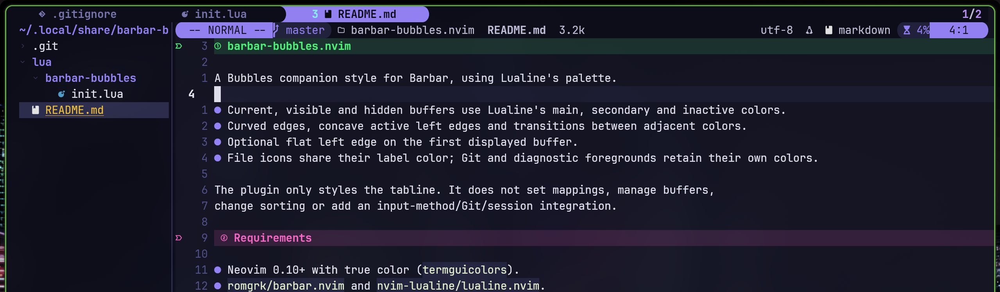

# barbar-bubbles.nvim



The screenshot pairs this tabline style with a customized version of Lualine's
[Bubbles example](https://github.com/nvim-lualine/lualine.nvim/blob/master/examples/bubbles.lua).
Lualine's components are placed in `winbar` rather than the bottom statusline,
producing the second bar at the top. Barbar provides the buffer tabs above it;
this plugin styles those tabs and does not move Lualine itself.

A Bubbles companion style for Barbar, using Lualine's palette.

- Current, visible and hidden buffers use Lualine's main, secondary and inactive colors.
- Curved edges, concave active left edges and transitions between adjacent colors.
- Optional flat left edge on the first displayed buffer.
- File icons share their label color; Git and diagnostic foregrounds retain their own colors.

The plugin only styles the tabline. It does not set mappings, manage buffers,
change sorting or add an input-method/Git/session integration.

## Requirements

- Neovim 0.10+ with true color (`termguicolors`).
- `romgrk/barbar.nvim` and `nvim-lualine/lualine.nvim`.
- A font containing the `` and `` separators.

Configure Lualine before applying this style. Its `lualine_a_normal`,
`lualine_b_normal` and `lualine_a_inactive` highlight groups supply the colors.
The render adapter uses Barbar's internal `barbar.ui.render.set_tabline` function:
compatibility should be checked when Barbar changes its renderer.

## Installation with vim.pack (Neovim 0.12+)

Install the style alongside Barbar and Lualine:

```lua
vim.g.barbar_auto_setup = false
vim.pack.add {
  'https://github.com/romgrk/barbar.nvim',
  'https://github.com/nvim-lualine/lualine.nvim',
  'https://github.com/zxzxn3/barbar-bubbles.nvim',
}

require('lualine').setup {}
local bubbles = require('barbar-bubbles')
require('barbar').setup(vim.tbl_deep_extend('force', {
  -- Your Barbar behavior goes here.
}, bubbles.barbar_options))
bubbles.setup { flat_first = true }
```

For a lazy.nvim specification, use:

```lua
{
  'zxzxn3/barbar-bubbles.nvim',
  dependencies = { 'romgrk/barbar.nvim', 'nvim-lualine/lualine.nvim' },
  init = function() vim.g.barbar_auto_setup = false end,
  config = function()
    -- Use your own Lualine setup here instead of the minimal defaults.
    require('lualine').setup {}
    local bubbles = require('barbar-bubbles')
    require('barbar').setup(bubbles.barbar_options)
    bubbles.setup { flat_first = true }
  end,
}
```

Do not let Barbar auto-configure before merging `barbar_options`; configure it
explicitly as shown. Keep your own Lualine setup instead of replacing it with
the minimal example. Apply your colorscheme after plugin setup; the style then
refreshes on `ColorScheme` events.

## API

- `barbar_options`: merge these separator/icon settings into `barbar.setup()`.
- `setup({ flat_first = true })`: apply colors and install the render adapter.
  `false` retains the first buffer's curved left edge. Repeated setup calls do
  not stack adapters; restart Neovim to change this option.

To disable the style, omit both the options merge and `setup()`, then restart.
Update the installed copy with
`vim.pack.update({ 'barbar-bubbles.nvim' })`.

## Tested setup

Used daily in Neovide. Tested with vim.pack and lazy.nvim, including theme
changes and repeated setup. Colors were checked with Nightfall, SilkCircuit,
Gruvbox, and Ocean.

Theme refresh is scheduled, so the previous palette may appear briefly when
changing colorschemes.

## License

Licensed under the GNU General Public License v3.0 only (GPL-3.0-only).
See [LICENSE](LICENSE).
